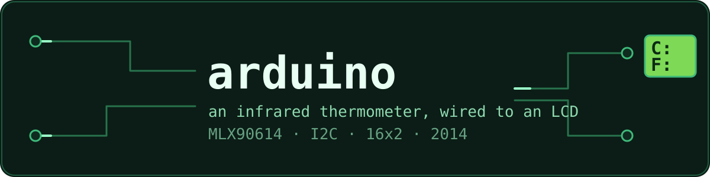
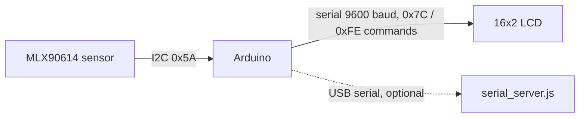

<p align="center"></p>

<p align="center">
  
  
  
</p>

> [!NOTE]
> **Historical project (Feb to Mar 2014).** A hobby sketchbook, not maintained and not re-tested on real hardware. Kept for the record. See [docs/STATUS.md](docs/STATUS.md).

# arduino

A small Arduino sketchbook from early 2014: an LCD "hello world", and a sketch that reads an **MLX90614 infrared thermometer** over I2C and shows the temperature in Celsius and Fahrenheit on a 16x2 serial LCD. There is also a tiny Node script that prints whatever the board sends over USB serial.

## What's in it

- `lcd_screen/main_cpp/main_cpp.ino`: talks to a 16x2 serial-controlled LCD (backlight, cursor positioning, top and bottom line helpers) and prints two lines of text. The sketch's own demo text is "Hola mundi" and "soak my cork".
- `ift/MLX90614.ino`: reads the object temperature from the MLX90614 at I2C address `0x5A` and prints Celsius and Fahrenheit to the serial monitor.
- `ift/infared_thermometer/infared_thermometer.ino`: the same reading, but written to the LCD (`C:` on the top line, `F:` on the bottom). Written by Neil Johnson.
- `serial_server.js`: a Node script that opens a serial port and echoes each line the Arduino prints. The port name (`/dev/cu.usbmodem1411`) is a macOS example; change it to your own.
- `vendor/I2Cmaster/`: a vendored third-party I2C library, see below.

## Hardware (as far as the code says)

- An Arduino with hardware I2C (SDA on A4, SCL on A5, as the sketches enable pull-ups on `PORTC4` and `PORTC5`, which is an Uno-class board). **(inference)**
- An MLX90614 infrared thermometer module on I2C address `0x5A`.
- A 16x2 LCD with a serial backend that accepts `0x7C` (backlight) and `0xFE` (cursor) command bytes at 9600 baud. **(inference)** This matches the common SparkFun-style serial LCD backpacks; the code does not name the part.

## Install and use

This is plain Arduino IDE (1.x era) territory. There is no build system.

1. Copy `vendor/I2Cmaster/` into your Arduino libraries folder (the original note says `~/Documents/Arduino/libraries`) so that `#include <i2cmaster.h>` resolves.
2. Open one of the `.ino` sketches in the Arduino IDE, pick your board and port, and upload.
3. For the Node script (optional): install the 2014-era `serialport` package, edit the port name, then `node serial_server.js`. It uses the old `serialport.SerialPort` and `parsers.readline` API, which current `serialport` releases no longer have, so expect to port it.

Wiring, in the style of the sketches: the thermometer on SDA and SCL, the LCD on the board's TX pin (it is driven through `Serial`), both on 5 V and ground. Check your own module's datasheet before powering anything.

## How it works



The sensor returns a 16-bit raw value in units of 0.02 K. The sketch masks the error bit, multiplies by 0.02, subtracts 273.15 for Celsius, and converts to Fahrenheit.

## Layout

```
lcd_screen/main_cpp/main_cpp.ino        LCD demo
ift/MLX90614.ino                        sensor to serial monitor
ift/infared_thermometer/*.ino           sensor to LCD
serial_server.js                        Node serial echo (old serialport API)
vendor/I2Cmaster/                       vendored Peter Fleury I2C master library (GPLv3)
vendor/README.txt                       original install note
docs/                                   status and banner
```

## Vendored code and credits

`vendor/I2Cmaster/` is the **I2C master library by Peter Fleury** (`i2cmaster.h`, `twimaster.cpp`, `keywords.txt`), copied unchanged, with its original `License.txt`. That library is distributed under the **GNU GPL v3 or later**; see `vendor/I2Cmaster/License.txt`. The thermometer sketch is by **Neil Johnson**; the LCD sketch is by Steven Zeiler.

This repository has no top-level licence file yet, so the sketches themselves carry no stated licence. Ask before reusing them.

## History

- **2014-02-21:** Steven adds the LCD screen sketch.
- **2014-03-02:** Neil Johnson adds the infrared thermometer sketch that reads the sensor and drives the LCD.
- Two commits in total. A short hobby-electronics detour from the Ripple-era work around it.

---

Status and what was checked: [docs/STATUS.md](docs/STATUS.md). Notes for coding agents: [AGENTS.md](AGENTS.md).
